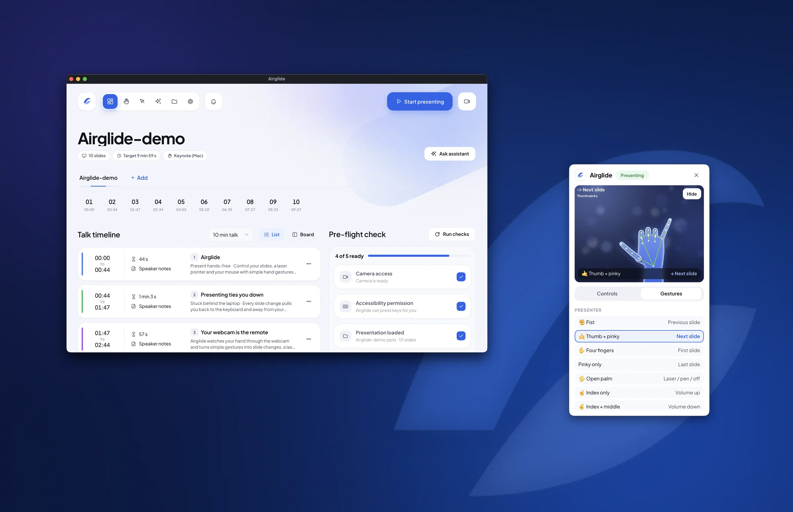
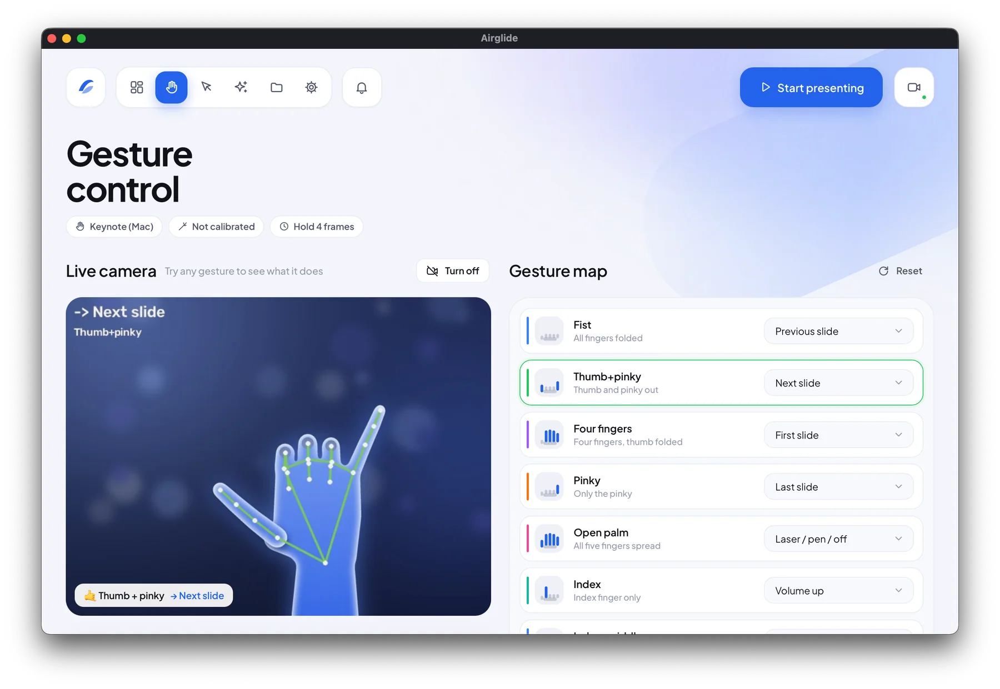
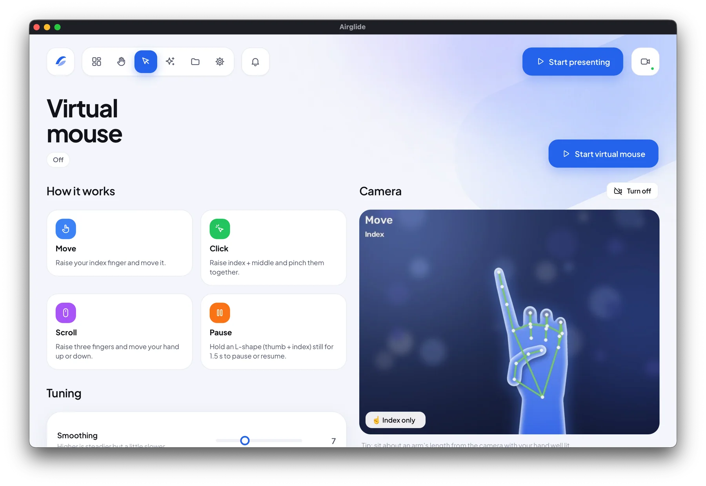
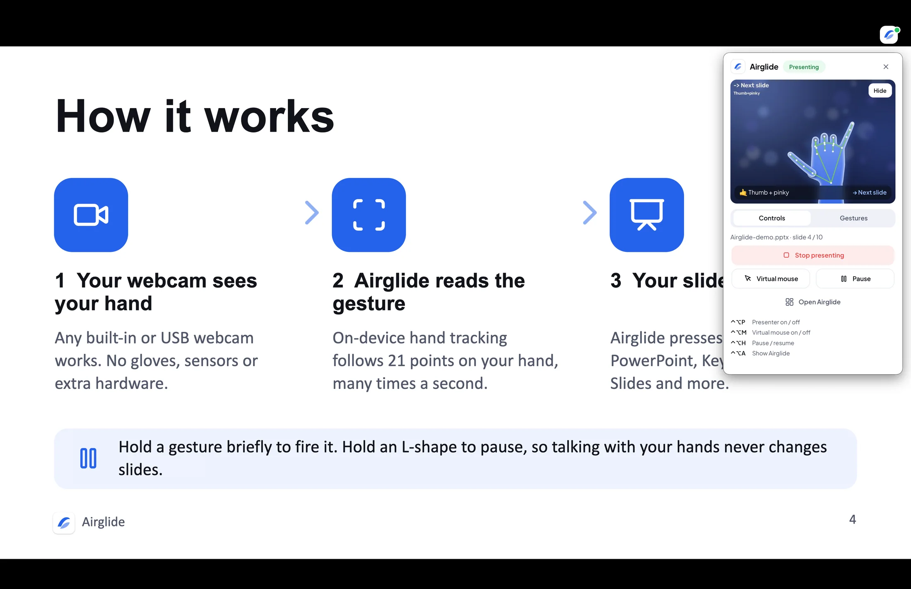
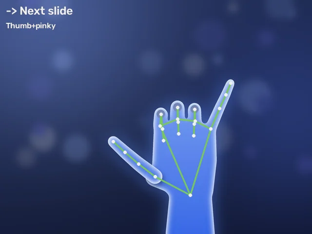
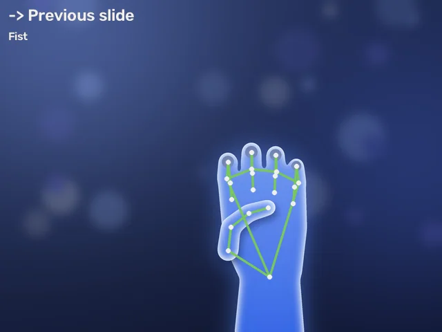
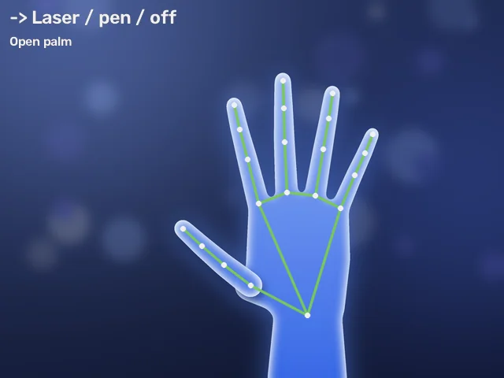
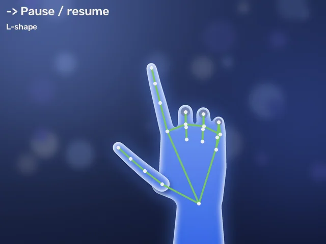

<div align="center">


# Airglide-web

**The website for [Airglide](https://github.com/sushilydv-dev/Airglide), the gesture-controlled presentation app.**

Present hands-free: change slides, point, draw and click with simple hand gestures, using only your webcam.

[Download Airglide](https://github.com/sushilydv-dev/Airglide/releases/latest) · [App repository](https://github.com/sushilydv-dev/Airglide) · [Report an issue](https://github.com/sushilydv-dev/Airglide/issues)




</div>

---

## What is Airglide?

[Airglide](https://github.com/sushilydv-dev/Airglide) is a **gesture-controlled presentation app** for **macOS** and
**Windows 10/11**. It watches your hand through an ordinary webcam and turns simple hand shapes into the keys your
slides understand: next, previous, first, last, black screen and exit. Open your palm for a laser pointer or a pen,
use your hand as a mouse, and ask an AI assistant that has read your deck for talking points or likely audience
questions.

There's no clicker, no gloves and no account. It works with PowerPoint, Keynote, Google Slides, LibreOffice
Impress, PDF viewers and Word documents, and the video and the AI both stay on your computer.

| | | |
|---|---|---|
|  |  |  |
| **Gesture control:** ten hand shapes, each mapped to an action | **Virtual mouse:** point, pinch to click, scroll | **On stage:** a quick panel over full-screen slideshows |

<p align="center">
  
  
  
  
  <br />
  <sub>Next slide · Previous slide · Laser / pen · Pause</sub>
</p>

This repository is the **website** where people learn about Airglide and download it. The app itself lives in
[sushilydv-dev/Airglide](https://github.com/sushilydv-dev/Airglide).

## Overview

Airglide-web is a fully static site: there is no server or database. Visitors download the installers straight
from [GitHub Releases](https://github.com/sushilydv-dev/Airglide/releases), and the latest version number, file
sizes and release notes are read from GitHub's public API in the visitor's browser.

### Pages

| Route | What it shows |
|---|---|
| `/` | Home: hero, what Airglide is, the five tools, how it works, the ten gestures, presenting in full screen, privacy, FAQ |
| `/download` | macOS and Windows installers (the visitor's system is highlighted), install steps, first-launch security help |
| `/docs` | Setup, permissions, gestures, virtual mouse, pointer and pen, shortcuts, AI assistant, troubleshooting |
| `/changelog` | Release notes, loaded live from GitHub |
| `/privacy` | What the app and the website do with data |

### Highlights

- **Light and dark themes** using the app's own colour tokens. Light is the default; visitors can switch to dark or match their system
- **Motion**: smooth scrolling, masked line reveals, a paragraph that lights up word by word, a pinned
  horizontally scrolling feature section, a scroll-speed marquee, magnetic buttons, a custom cursor, an intro
  loader and page transitions
- **Interactive gesture showcase** with camera illustrations of every default gesture
- **OS-aware download button** that offers the right installer automatically
- **Accessible**: keyboard navigation, focus rings, ARIA roles on tabs and accordions, and full respect for
  "reduce motion"
- **Fast**: WebP images, code-split pages, long-term caching of static assets

## Tech stack

| | |
|---|---|
| Build | [Vite](https://vite.dev) |
| UI | [React](https://react.dev) + [React Router](https://reactrouter.com) |
| Styling | [Tailwind CSS v4](https://tailwindcss.com) |
| Animation | [Motion](https://motion.dev) + [Lenis](https://lenis.darkroom.engineering) smooth scroll |
| Components | [Radix UI](https://www.radix-ui.com) (accordion, dialog), [Lucide](https://lucide.dev) icons |
| Content | [react-markdown](https://github.com/remarkjs/react-markdown) for release notes |
| Images | [sharp](https://sharp.pixelplumbing.com) (build-time WebP conversion) |
| Hosting | [Vercel](https://vercel.com) |

## Getting started

Requires **Node.js 20+**.

```sh
git clone https://github.com/sushilydv-dev/Airglide-web.git
cd Airglide-web
npm install
npm run dev
```

Open http://localhost:5173.

### Scripts

| Command | Description |
|---|---|
| `npm run dev` | Start the dev server with hot reload |
| `npm run build` | Build the static site into `dist/` |
| `npm run preview` | Serve the production build locally |
| `npm run images -- "<folder>"` | Regenerate the images, icons, social preview and demo deck from a "website assets" folder |

## Project structure

```
├── public/                 Static files served as-is
│   ├── images/             Screenshots and camera illustrations (WebP)
│   ├── Airglide-demo.pptx  Demo deck offered for download
│   └── favicon.svg, icon-512.png, apple-touch-icon.png, og-image.jpg
├── scripts/
│   └── optimize-images.mjs Converts the source assets into public/
├── src/
│   ├── main.jsx            Entry point
│   ├── App.jsx             Routes (inner pages are lazy-loaded)
│   ├── index.css           Design tokens, fonts and shared styles
│   ├── pages/              Home, Download, Docs, Changelog, Privacy, NotFound
│   ├── sections/           The sections of the home page
│   ├── components/         Layout, navigation, footer and motion building blocks
│   ├── data/               Gestures and FAQ content
│   ├── lib/                Site links, theme, OS detection, GitHub release data, scrolling
│   └── fonts/absans/       Absans font files and licence
├── index.html              HTML shell, SEO and social meta tags
├── vercel.json             Page routing and caching headers
└── vite.config.js
```

## Downloads and releases

The download buttons link to stable URLs that always point at the newest release:

```
https://github.com/sushilydv-dev/Airglide/releases/latest/download/Airglide-macos.dmg
https://github.com/sushilydv-dev/Airglide/releases/latest/download/Airglide-windows-setup.exe
https://github.com/sushilydv-dev/Airglide/releases/latest/download/Airglide-windows.zip
```

The Airglide app's release workflow publishes these version-free file names with every release, so **this site
never needs to change when a new version ships**. To release a new version, push a tag such as `v2.1.0` in the
[app repository](https://github.com/sushilydv-dev/Airglide); the version, sizes and changelog here update by
themselves. The URLs live in [`src/lib/site.js`](src/lib/site.js).

## Deployment

The site is designed for [Vercel](https://vercel.com):

1. In Vercel, choose **Add New → Project** and import this repository.
2. Vercel detects Vite automatically: build command `npm run build`, output directory `dist`.
3. Deploy. Every push to `main` redeploys, and pull requests get preview URLs.

[`vercel.json`](vercel.json) sends every page route to the app (so `/docs` or `/download` work when opened
directly) and caches images and built assets for a year. Any other static host works too, as long as unknown
paths fall back to `index.html`.

## Design

- **Colours**: the Airglide app's tokens (`views/app.css` in the app repository), in light and dark variants,
  defined in [`src/index.css`](src/index.css). Primary blue `#2563EB` (`#4F86FF` in dark mode) on `#F3F5FB` /
  `#0D1017` backgrounds, with navy `#0B1633` for feature sections.
- **Typography**: Absans by [Collletttivo](https://www.collletttivo.it/) for everything. It has a single weight,
  so synthetic bold and italic are disabled and hierarchy comes from size, case and colour.
- **Camera imagery**: illustrated hands with Airglide's real tracking overlay; no real webcam footage is used.

## Credits and licences

- **Absans** © 2023 Collletttivo, licensed under the [SIL Open Font License 1.1](src/fonts/absans/LICENSE.txt).
- Open-source libraries are used under their own licences; see `package.json`.
- Airglide, its name, logo and screenshots belong to the Airglide project.
